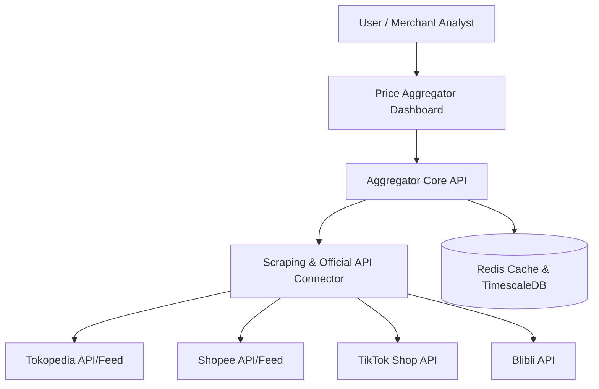

# E-Commerce Multi-Marketplace Price Comparison & Aggregator Tool

[](https://www.typescriptlang.org)
[](https://react.dev)
[](https://nodejs.org)
[]()

**Price Aggregator** is a multi-marketplace e-commerce intelligence and price comparison engine designed to track, compare, and aggregate product pricing, stock availability, and promotional discounts across Southeast Asia's major e-commerce platforms (Tokopedia, Shopee, TikTok Shop, Blibli, Lazada).

---

## 🌟 Key Capabilities

### 1. Cross-Marketplace Price Tracking
- **Multi-Platform Search**: Search by product title, SKU, or barcode (EAN/UPC) across multiple marketplaces simultaneously.
- **True Price Comparison**: Calculates final landing price including shipping subsidies, voucher discounts, and cashbacks.
- **Merchant Price Intelligence**: Benchmark competitor pricing to dynamically optimize profit margins.

### 2. Historical Price Charts & Volatility Index
- Track price fluctuation over time (30d / 90d / 1y) to detect fake discounts during promotional campaigns (11.11, 12.12, Payday Sales).

### 3. Price Drop Alerts & Webhook Notifications
- Automated notifications dispatched via Telegram, Discord, or WhatsApp when target threshold prices are reached.

---

## 🏗️ Architecture Overview



---

## 🚀 Local Setup

```bash
# Clone the repository
git clone https://github.com/aliakhmadfauzie/price-aggregator.git
cd price-aggregator

# Install dependencies
npm install

# Start development server
npm run dev
```

---

## 📄 License
Developed by **Ali Akhmad Fauzie** ([@aliakhmadfauzie](https://github.com/aliakhmadfauzie)). MIT License.
